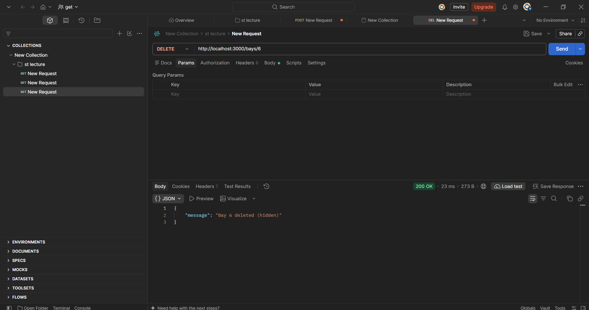
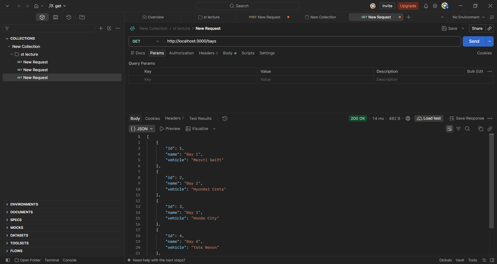
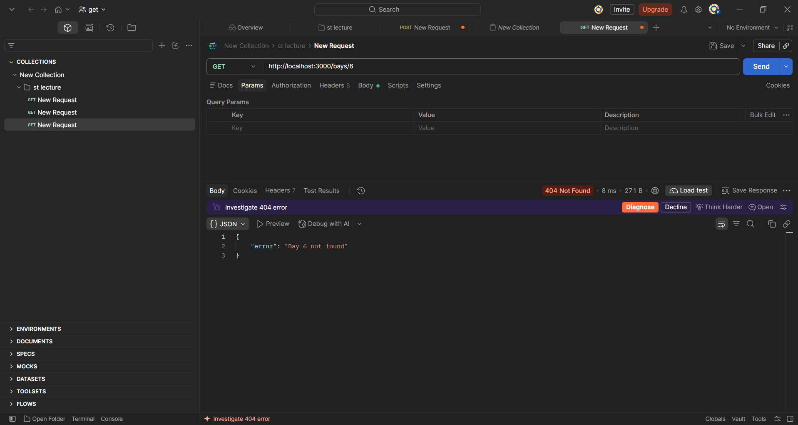
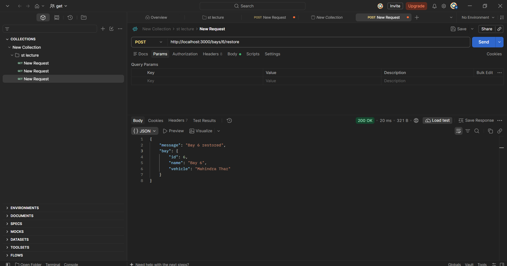
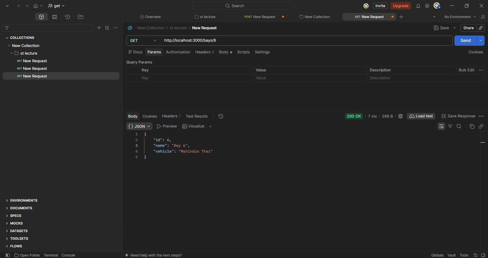
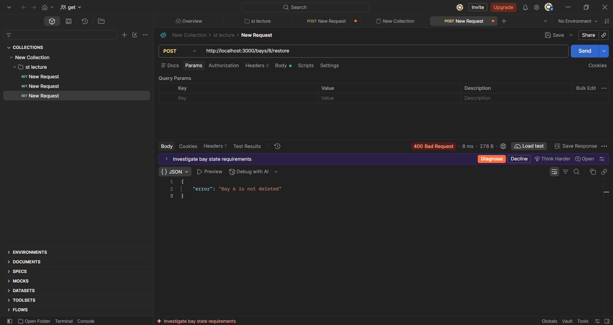
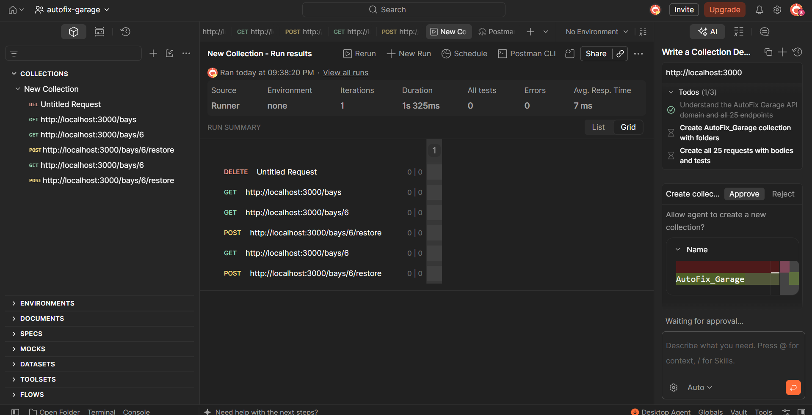

# AutoFix Garage – Service Bays API

## 1. Project Overview

**AutoFix Garage – Service Bays API** is a backend application developed using Node.js, Express.js, and SQLite.

In a garage, service bays are often assigned verbally. This can cause overlapping jobs and confusion about which bay is available.

This project provides REST APIs to manage mechanics, service bays, and assignments. It helps organize garage operations and prevents duplicate bay assignments.

## 2. Technologies Used

- Node.js
- Express.js
- SQLite
- JavaScript
- Postman

## 3. Team Members and Contributions

S. No. Student Name Roll Number Individual Contribution
1 Amara Srividya 9007 Server setup and routes
2 Gurrala Sujith 9045 Database creation and queries
3 Golla Ganesh 9041 REST API endpoints
4 Avula Druvathi 9014 Validation and search
5 Chenchu Dinesh 9024 Postman testing and README documentation
6 Kothapally Hari Priya 9075 Implemented soft delete and restore functionality for bays, hid deleted bays from lists and single-record fetches, and verified Twist Tests 1–3.

## 4. How to Run the Project

### Step 1: Clone the Repository

```bash
git clone <your-github-link>
```

### Step 2: Open the Project Folder

```bash
cd autofix-garage
```

### Step 3: Install Dependencies

```bash
npm install
```

### Step 4: Start the Server

```bash
npm start
```

The server will run at:

```text
http://localhost:3000
```

The SQLite database (`autofix.db`) is created automatically, and sample data is inserted when the application initializes.

## 5. Database Design

The project uses three tables.

### Mechanics Table

Stores mechanic details.

| Column    | Description        |
| --------- | ------------------ |
| id        | Mechanic ID        |
| name      | Mechanic name      |
| specialty | Mechanic specialty |

### Bays Table

Stores service bay details.

| Column  | Description                 |
| ------- | --------------------------- |
| id      | Bay ID                      |
| name    | Bay name                    |
| vehicle | Vehicle assigned to the bay |
| deleted | Soft-delete status          |

### Assignments Table

Stores mechanic and bay assignments.

| Column      | Description           |
| ----------- | --------------------- |
| id          | Assignment ID         |
| mechanic_id | Assigned mechanic ID  |
| bay_id      | Assigned bay ID       |
| job         | Job description       |
| start_time  | Assignment start time |

## 6. API Endpoints

### Service Bays

| Method | Endpoint            | Description           |
| ------ | ------------------- | --------------------- |
| GET    | `/bays`             | Get all active bays   |
| GET    | `/bays/:id`         | Get a bay by ID       |
| POST   | `/bays`             | Create a new bay      |
| PUT    | `/bays/:id`         | Update a bay          |
| DELETE | `/bays/:id`         | Soft-delete a bay     |
| POST   | `/bays/:id/restore` | Restore a deleted bay |

### Mechanics

| Method | Endpoint         | Description          |
| ------ | ---------------- | -------------------- |
| GET    | `/mechanics`     | Get all mechanics    |
| GET    | `/mechanics/:id` | Get a mechanic by ID |
| POST   | `/mechanics`     | Add a new mechanic   |

### Assignments

| Method | Endpoint       | Description                                   |
| ------ | -------------- | --------------------------------------------- |
| GET    | `/assignments` | Get assignments with mechanic and bay details |
| POST   | `/assignments` | Create a new assignment                       |

## 7. Validation and Search

The application includes input validation to ensure that the API receives valid data.

- Name is required and must be text with a maximum length of 50 characters.
- Vehicle is required and must be text with a maximum length of 100 characters.
- ID must be a positive integer.
- Search functionality allows users to search bays using vehicle or bay name.
- Duplicate bay assignments are prevented.

## 8. Special Feature – Soft Delete and Restore

The project implements a soft-delete feature for service bays.

Instead of permanently deleting a bay from the database, its `deleted` value is changed.

- **DELETE `/bays/6`** – Marks Bay 6 as deleted.
- **GET `/bays`** – Does not display deleted bays.
- **GET `/bays/6`** – Returns 404 when the bay is deleted.
- **POST `/bays/6/restore`** – Restores the deleted bay.
- **GET `/bays/6`** – Returns the bay after restoration.
- Restoring a bay that is already active returns a 400 error.

## 9. Postman Testing Screenshots

The APIs were tested using Postman. The following screenshots demonstrate the soft-delete and restore functionality and the overall test results.

**Screenshot 1: Delete Bay 6**

DELETE `/bays/6`

Expected result: 200 OK. Bay 6 is marked as deleted.



**Screenshot 2: Get All Bays**

GET `/bays`

Expected result: 200 OK. Bay 6 should not appear in the response.



**Screenshot 3: Get Deleted Bay**

GET `/bays/6`

Expected result: 404 Not Found because Bay 6 is deleted.



**Screenshot 4: Restore Bay 6**

POST `/bays/6/restore`

Expected result: 200 OK. Bay 6 is restored successfully.



**Screenshot 5: Get Restored Bay**

GET `/bays/6`

Expected result: 200 OK. Bay 6 is available again.



**Screenshot 6: Restore an Already Restored Bay**

POST `/bays/6/restore`

Expected result: 400 Bad Request because the bay is already active.



**Screenshot 7: Postman Collection Runner Results**

The complete Postman collection was executed using the Collection Runner.

Expected result: 25 tests passed and 0 tests failed.



## 10. Postman Collection

The Postman collection contains 25 requests covering different API functionalities.

The requests are organized into the following categories:

- Service Bays CRUD
- Validation
- Search
- Soft Delete and Restore
- Assignments and JOIN
- Mechanics

The collection file is available at:

```text
postman/AutoFix_Garage.postman_collection.json
```

The collection uses the following variable:

| Variable | Value                   |
| -------- | ----------------------- |
| baseUrl  | `http://localhost:3000` |

## 11. Project Structure

```text
autofix-garage/
│
├── app.js
├── server.js
├── package.json
├── autofix.db
│
│
├── screenshots/
│   ├── 01_Delete_Bay_6.png
│   ├── 02_Get_All_Bays.png
│   ├── 03_Get_Deleted_Bay.png
│   ├── 04_Restore_Bay_6.png
│   ├── 05_Get_Restored_Bay.png
│   ├── 06_Restore_Already_Restored.png
│   └── 07_Postman_Test_Results.png
│
└── README.md
```

## 12. Conclusion

The AutoFix Garage – Service Bays API provides a simple way to manage service bays, mechanics, and assignments. It supports CRUD operations, validation, search, and JOIN queries. The soft-delete and restore feature helps manage service bays without permanently removing records. All API functionalities were tested using Postman.
